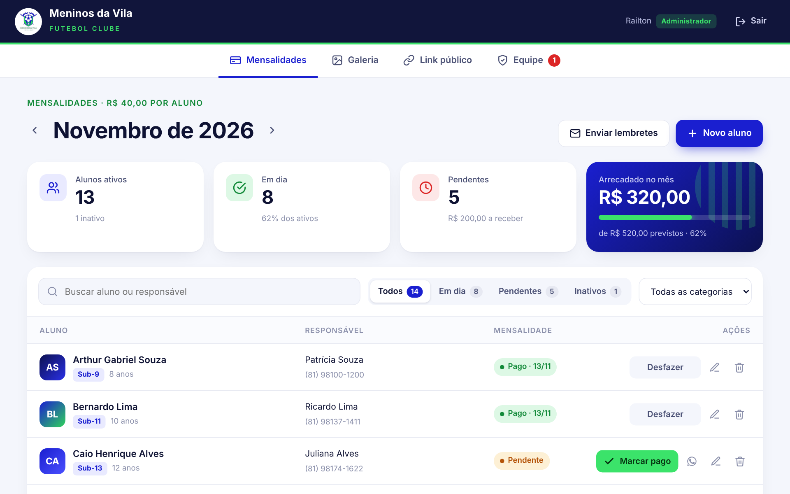
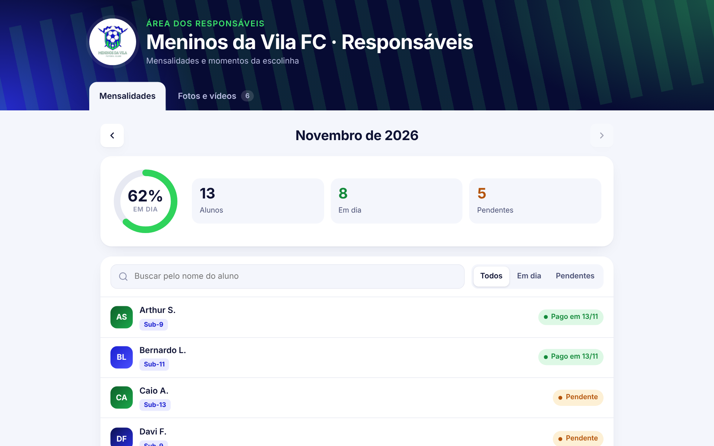
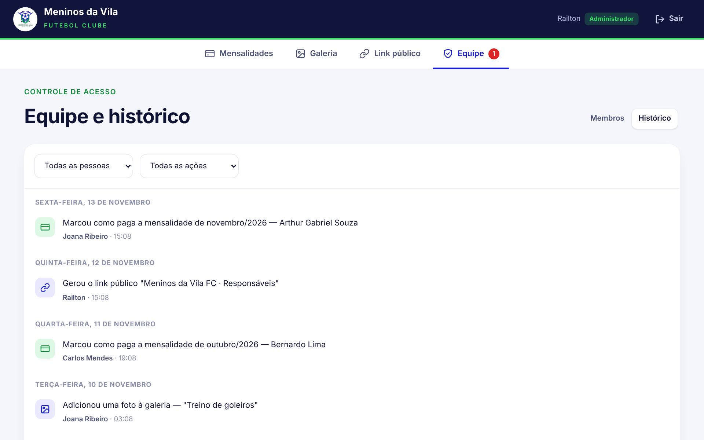
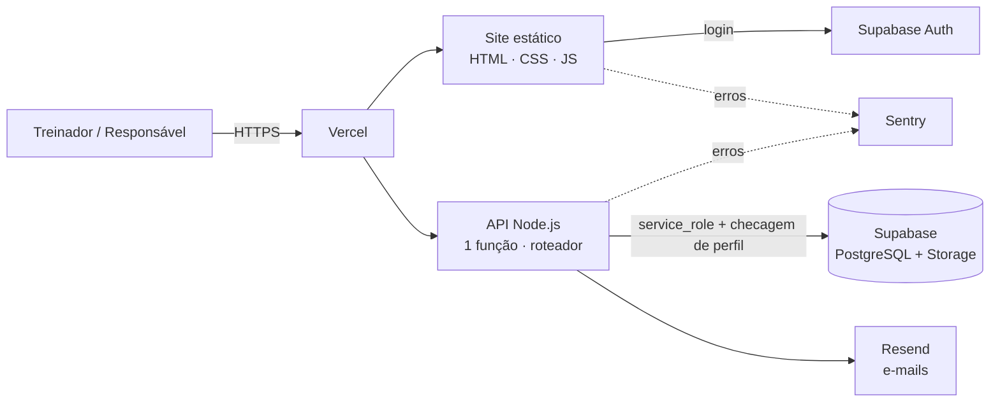

<div align="center">


# Meninos da Vila FC · Gestão de alunos e mensalidades

**Sistema web para uma escolinha de futebol real: cadastro de alunos, controle de mensalidades, área pública para os responsáveis e controle de acesso por perfil, com testes E2E automatizados.**


### [▶ Abrir a demonstração](https://LINK-DA-DEMO.vercel.app)
<sub>Dados fictícios: entre com qualquer e-mail e senha. Na faixa verde, "Ver como" troca entre Administrador, Treinador e Cadastro pendente.</sub>

</div>

---

## O problema

Na escolinha **Meninos da Vila FC**, o controle de quem estava matriculado e de quem tinha pago a mensalidade (R$ 40,00) ficava espalhado entre caderno e conversas de WhatsApp. Saber quem estava pendente no mês exigia conferir tudo à mão, e os responsáveis não tinham onde acompanhar.

## A solução

Um painel web, pensado para uso no celular, onde o treinador:

- cadastra os alunos (com a categoria calculada pela idade, de **Sub-7** a **Sub-17**);
- marca a mensalidade como paga em **um clique** e vê, mês a mês, quem está em dia e quem está pendente;
- cobra pelo **WhatsApp** com a mensagem pronta;
- compartilha com os pais um **link público** com a situação das mensalidades e a **galeria de fotos e vídeos** dos treinos;
- aprova novos treinadores e acompanha o **histórico** de quem fez o quê.

<p align="center">
  
</p>

<table>
  <tr>
    <td width="50%"><p align="center"><sub>Página dos responsáveis (nomes abreviados por padrão)</sub></p></td>
    <td width="50%"><p align="center"><sub>Histórico: quem fez o quê e quando</sub></p></td>
  </tr>
</table>

<p align="center">
  
</p>

> Todas as imagens são do **modo demonstração**, com dados fictícios. Nenhum dado real de alunos é publicado neste repositório.

---

## Qualidade: o foco do projeto

Sou **QA Engineer** e apliquei a mentalidade de qualidade do primeiro requisito até a produção.

### Testes E2E automatizados (Cypress): 22 casos

| Área | Casos | O que garante |
|---|:---:|---|
| Login e criação de conta | 7 | Validações, entrada, saída e regras de senha |
| Cadastro de aluno | 5 | Categoria automática, máscara do WhatsApp, validações e edição |
| Pagamento | 5 | Indicadores (+R$ 40,00), desfazer, pagamento válido só no mês marcado, histórico |
| Permissões por perfil | 5 | Treinador sem acesso à Equipe, redirecionamento por URL, tela de espera |

**Estratégia:**
- **Modo demonstração:** os testes rodam no site sem backend, com dados fictícios, então são **repetíveis e nunca tocam dados reais**.
- **Trava de segurança:** se alguém apontar a suíte para o site em produção, os testes param antes de criar qualquer dado.
- **Regras de negócio:** além da interface, os testes conferem os **indicadores financeiros**.

📄 O plano de testes completo, com a tabela de casos e as instruções, está em [`cypress/README.md`](cypress/README.md).

### Bugs encontrados pelos testes

| ID | Bug | Impacto | Status |
|---|---|---|---|
| BUG-01 | A máscara do WhatsApp embaralhava os dígitos ao digitar (`81999990000` → `(81) 9999-90`) | Cobrança enviada para o número errado | ✅ Corrigido |
| BUG-02 | Um clique em "Criar conta" logo após abrir a página se perdia (condição de corrida) | Usuário precisava clicar de novo | ✅ Corrigido |

### Problemas de produção investigados

| Sintoma | Causa raiz | Solução |
|---|---|---|
| Build concluído, mas o deploy falhava | O plano gratuito da Vercel permite no máximo **12 funções**, e a API tinha 15 | A API foi reorganizada em **uma única função** com roteador interno |
| Login recusado com "Invalid path specified" | A URL do Supabase foi configurada com `/rest/v1/` no final | O servidor passou a normalizar a URL |
| Usuário "saía da conta" logo após entrar, sem mensagem | Chave `service_role` de outro projeto | Erro de configuração passou a ser exibido, em vez de deslogar em silêncio |
| Deploys bloqueados no GitHub | E-mail do autor dos commits não vinculado à conta | Identidade do Git corrigida e histórico reescrito |

### Segurança e privacidade (LGPD)

- **Permissões no servidor:** cada rota da API confere o perfil (administrador, treinador, pendente ou bloqueado). A regra não fica só escondida na tela.
- **Banco protegido:** RLS ligado e **sem políticas públicas**. O navegador nunca acessa as tabelas diretamente.
- **Dados de menores no link público:** nomes abreviados ("Arthur S."), sem telefone, e-mail ou data de nascimento; o link pode ser desativado e ter validade; a página não aparece no Google (`noindex`).
- **Equipe segura:** ninguém altera o próprio acesso, e a escolinha nunca fica sem administrador.

---

## Arquitetura



**Decisões técnicas:**
- **API em uma única função:** respeita o limite do plano gratuito sem perder a organização em rotas (`api/_rotas/`).
- **Uploads direto para o Storage, com URL assinada:** fotos e vídeos não passam pelo limite de 4,5 MB das funções.
- **Modo demonstração embutido:** sem backend configurado, o site funciona com dados fictícios. Isso serve para demonstração e para os testes.

## Tecnologias

**Front:** HTML, CSS e JavaScript (sem framework) · **API:** Node.js (Vercel Functions) · **Banco e login:** Supabase · **E-mail:** Resend · **Monitoramento:** Sentry · **Testes:** Cypress · **Versionamento:** GitHub

---

## Como rodar

```bash
git clone https://github.com/RailtonSilva/meninos-da-vila.git
cd meninos-da-vila
npm install

# Site em modo demonstração (dados fictícios, sem configurar nada)
npm run demo                 # http://localhost:5500

# Testes E2E (em outro terminal)
npx cypress run              # ou: npm run cy:open
```

Para rodar com o banco de verdade (Supabase, Vercel, Resend, Sentry e Cloudflare), siga o **[guia de configuração](docs/CONFIGURACAO.md)**.

---

## Sobre o desenvolvimento

O projeto foi desenvolvido **com apoio de IA**. O meu papel foi definir os requisitos com base na necessidade real da escolinha, testar cada funcionalidade, escrever a suíte de testes, investigar e reportar os bugs, e decidir as correções e a configuração da infraestrutura.

## Autor

**Railton da Silva Maranhão** · QA Engineer
[LinkedIn](https://www.linkedin.com/in/SEU-PERFIL) · [GitHub](https://github.com/RailtonSilva)
